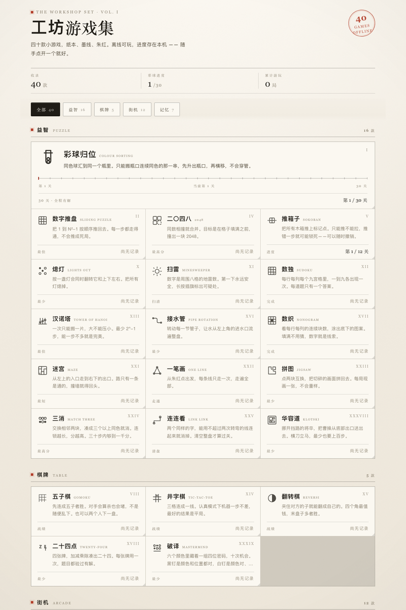
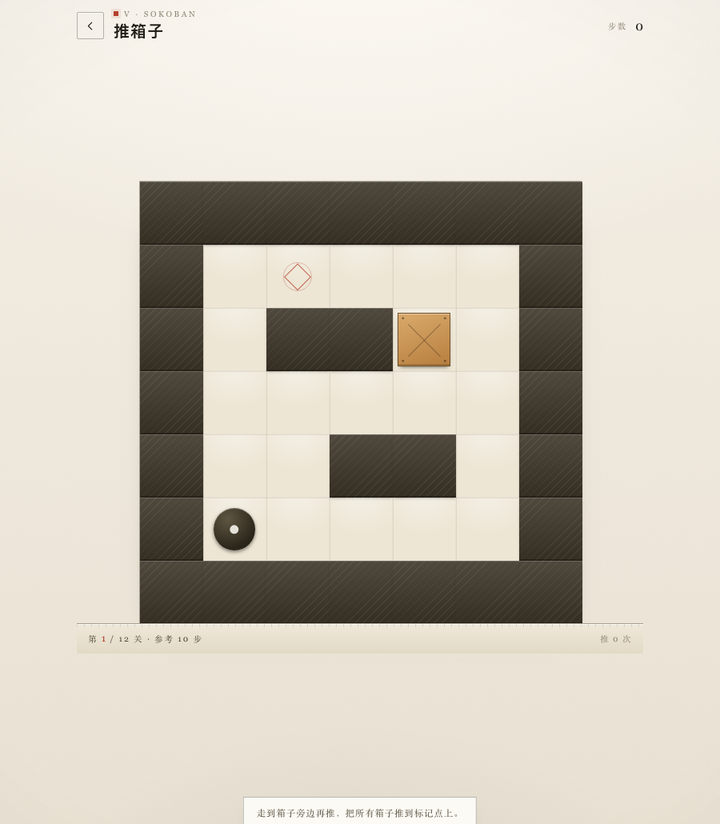

# 工坊游戏集 · The Workshop Set

**四十款小游戏，纸本、墨线、朱红。离线可玩，进度存在本机。**

[](#游戏目录)
[](#技术实现)
[](#技术实现)
[](#android-版)

一个由 40 个独立 HTML 页面组成的迷你街机厅：益智 16 款、棋牌 5 款、街机 12 款、记忆 7 款。没有框架、没有依赖、没有联网请求，双击打开就能玩；另附一个 228 KB 的 Android 离线壳，装进手机也不占地方。

| 门厅 | 推箱子 | 跑酷 |
| :-: | :-: | :-: |
|  |  |  |

## 亮点

- **40 款小游戏，全部手写**：每一款都是独立的 HTML 文件，Canvas 2D 或原生 DOM 实现，不加载任何外部库、字体或图片。
- **门厅即进度中心**：按分类筛选、继续上次、查看各游戏的最佳成绩与关卡进度，另有一行累计游玩统计。
- **进度存在本机**：`localStorage` 按游戏分别存档，最佳成绩只升不降；清理浏览器数据才会重置。
- **声音也是合成的**：音效由 WebAudio 实时生成，没有音频文件；支持震动反馈与一键静音。
- **为手机做的纸面**：触控手势、安全区、竖屏布局、禁用页面滚动干扰，手机浏览器与桌面鼠标都能玩。
- **真正离线**：无网络请求、无 CDN。整个网页版约 1.3 MB，APK 仅 228 KB。
- **每款都能单独拿走**：游戏页彼此独立，复制一个 HTML 就能嵌到别处。

## 快速开始

网页版不需要安装任何东西：

```bash
git clone https://github.com/TongJX614/workshop-arcade.git
cd workshop-arcade/arcade
python3 -m http.server 8080
```

打开 <http://localhost:8080> 即可。也可以直接用浏览器打开 `arcade/index.html`（部分浏览器在 `file://` 下可能不保存进度，建议用上面的本地服务器）。

### Android 版

APK 在 [`android/dist/工坊游戏集-v1.7.apk`](android/dist/工坊游戏集-v1.7.apk)，传到手机安装即可，或：

```bash
adb install android/dist/工坊游戏集-v1.7.apk
```

## 游戏目录

### 益智 · Puzzle（16 款）

| 游戏 | 原名 | 玩法 |
| --- | --- | --- |
| 彩球归位 | Colour Sorting | 同色球汇进同一个瓶子，30 关全程有解 |
| 数字推盘 | Sliding Puzzle | 把 1 到 N²−1 按顺序推回原位 |
| 二〇四八 | 2048 | 同数相撞合并，在格子填满前撞出 2048 |
| 推箱子 | Sokoban | 木箱推上标记点，只能推不能拉，可随时撤销 |
| 熄灯 | Lights Out | 按一盏灯同时翻转十字五格，把所有灯熄掉 |
| 扫雷 | Minesweeper | 数字是周围八格的地雷数，第一下永远安全 |
| 数独 | Sudoku | 每行每列每宫 1–9 各出现一次，题目唯一解 |
| 汉诺塔 | Tower of Hanoi | 大不压小，最少 2ⁿ−1 步 |
| 接水管 | Pipe Rotation | 转动管件，让水从进水口流遍整盘 |
| 数织 | Nonogram | 按行列数字涂格，还原底下的图案 |
| 迷宫 | Maze | 从左上入口走到右下出口，只有一条通路 |
| 一笔画 | One Line | 每条线只走一次，走遍全部 |
| 拼图 | Jigsaw | 两两交换，把每局现画的画面拼回去 |
| 三消 | Match Three | 交换相邻方块，连锁消除，30 步冲 1000 分 |
| 连连看 | Link Link | 两次转弯以内连线，消掉相同的字 |
| 华容道 | Klotski | 挪开挡路的将卒，把曹操从底部出口送出去 |

### 棋牌 · Table（5 款）

| 游戏 | 原名 | 玩法 |
| --- | --- | --- |
| 五子棋 | Gomoku | 会算杀也会堵的 AI，也支持双人对下 |
| 井字棋 | Tic-Tac-Toe | 认真模式一步不差，最好的结果是平局 |
| 翻转棋 | Reversi | 夹住对方的子就能翻面，四角最值钱 |
| 二十四点 | Twenty-Four | 四张牌加减乘除凑 24，题目都验过有解 |
| 破译 | Mastermind | 六色四位密码，十次机会，黑钉位置对、白钉颜色对 |

### 街机 · Arcade（12 款）

| 游戏 | 原名 | 玩法 |
| --- | --- | --- |
| 贪吃蛇 | Snake | 吃到墨点就变长，越吃越快 |
| 打砖块 | Breakout | 板子接球敲砖，三颗球，关卡逐层加厚 |
| 落块 | Tetris | 七种方块旋转落下，消四行得分最高 |
| 乒乓 | Pong | 板边反弹改变角度，先到七分 |
| 太空侵略者 | Invaders | 敌阵越打越快，一波比一波密 |
| 跑酷 | Endless Run | 跳过石头，速度越来越快，看能跑多远 |
| 接落物 | Catch | 接住果子，别碰黑色炸弹 |
| 打地鼠 | Whack-a-Mole | 三十秒九洞，越到后面冒得越快 |
| 跳跃 | Flap | 点一下扇一次翅膀，从管缝里穿过去 |
| 投篮 | Hoops | 拉拽出手，六十秒看能进几个 |
| 叠塔 | Stack | 点一下落块，错开的部分会被切掉 |
| 切水果 | Slice | 划过去切开水果，别碰炸弹 |

### 记忆 · Mind（7 款）

| 游戏 | 原名 | 玩法 |
| --- | --- | --- |
| 记忆翻牌 | Memory | 成对翻牌，用最少次数记住全部位置 |
| 西蒙 | Simon Says | 四色依次亮起，照着顺序按回去 |
| 反应力 | Reaction | 纸面变红的一瞬立刻点，五轮取平均 |
| 心算冲刺 | Quick Math | 六十秒加减乘除，越答越难 |
| 数字记忆 | Number Memory | 数字一闪而过，照着打回去 |
| 猜词 | Wordle | 六次机会猜一个五字母英文词 |
| 找不同 | Spot the Difference | 上下两张图有三处不同，点出来 |

## 项目结构

```
游戏工坊/
├── arcade/                  # 网页版本体
│   ├── index.html           # 门厅：目录、筛选、进度、继续上次
│   ├── assets/
│   │   ├── shell.js         # 共享运行层：存档 / 音效 / 提示 / 结算 / 手势
│   │   ├── shell.css        # 纸本主题与通用控件
│   │   └── games.js         # 游戏清单（名称 / 分类 / 图标 / 进度读取）
│   ├── games/               # 40 个独立游戏页，每个一个 HTML
│   └── tools/               # 开发期自动化：测试、闯关、截图、关卡生成
├── ball-sort/index.html     # 「彩球归位」最早的单文件原型
├── android/                 # Android 离线壳
│   ├── src/                 # WebView Activity
│   ├── res/                 # 图标与主题
│   ├── AndroidManifest.xml
│   ├── build.sh             # 不依赖 Gradle 的打包脚本
│   ├── tools/               # 资源打包、图标生成、APK 校验
│   └── dist/                # 已签名 APK
├── docs/                    # README 截图
└── README.md
```

## 技术实现

**门厅是数据驱动的。** 所有游戏登记在 [`arcade/assets/games.js`](arcade/assets/games.js) 的 `GAMES` 数组里，每项包含名称、分类、图标路径、简介和一个读取存档的函数。新增一款游戏，只需加一项配置和一个 `games/xxx.html`，门厅的分类、筛选、进度卡片会自动出现。

**共享运行层** [`arcade/assets/shell.js`](arcade/assets/shell.js) 提供各游戏共用的能力：

- `Store`：带前缀 `arcade.v1.` 的 localStorage 封装，最佳成绩合并时只升不降；
- `Sound`：WebAudio 合成音效，无音频资源，支持全局开关；
- `haptic` / `toast` / `plate` / `hidePlate`：震动、轻提示与票券式结算面板；
- `swipe` / `bump` / `flash` / `floatNum` / `fmtTime` / `fmtNum` / `$` / `$$` 等小工具；
- `dpr` 与安全区适配，保证高分屏和刘海屏的版面一致。

**游戏页各自独立。** 不打包、不转译、不共享模块，Canvas 2D 与 DOM 按需使用。纸本主题的色板集中在 [`arcade/assets/shell.css`](arcade/assets/shell.css)：纸 `#F2EEE4`、墨 `#1F1C16`、朱红 `#B4402C`、松绿 `#2F6B63`。

**Android 壳没有第三方依赖。** `MainActivity` 通过 `shouldInterceptRequest` 把 `https://arcade.local/` 映射到 APK 内的 `assets/arcade/`：用虚拟 https 域名而不是 `file://`，是为了给 localStorage 一个稳定的安全来源，存档才不会丢；拦截失效时自动回退到 `file://` 直读。返回键优先关闭弹层，再回上一页。整个 APK 由 `aapt2 + javac + d8 + zipalign + apksigner` 直接产出，不需要 Gradle。

## 开发工具

`arcade/tools/` 下是一批零依赖的 Node 脚本，开发时用来把 40 个页面逐一跑一遍：

| 脚本 | 用途 |
| --- | --- |
| `cdp.js` | 极简 Chrome DevTools Protocol 客户端（Node 22 内置 WebSocket） |
| `test-pages.js` | 逐页冒烟测试，捕获运行时错误与关键交互 |
| `play.js` / `fuzz.js` | 真实浏览器里逐页实操 / 随机点击拖拽压测 |
| `start-check.js` / `react-check.js` | 检查「点开始有没有反应」「点一下有没有变化」 |
| `touch-test.js` | 模拟真手指在画布上滑动，验证手势不被浏览器吞掉 |
| `layout.js` | 390×844 视口下的横向溢出、控件可点区域、字号体检 |
| `audit.js` | 静态扫描 40 个页面：Shell API、资源路径、重复 id、未闭合标签 |
| `solve-balls.js` / `win-arcade.js` / `win-hanoi.js` | 自动通关/死亡链路，验证关卡可解与结算写档 |
| `gen-levels.js` / `gen-sokoban.js` | 生成关卡并用求解器验证有解 |
| `shot-once.js` / `shot-crop.js` / `shot-play.js` | 单帧 / 特写 / 对局中截图 |

`android/tools/` 里则是 `pack.py`（把网页资源打进 APK）、`make-icon.py`（纯像素绘制启动图标）、`check_apk.py`（清单、dex、资源与链接完整性校验）和 `sync-assets.py`。

> 这些脚本是在 Windows 开发机上写的，`ROOT`、`CHROME`、SDK 路径等按本机布局硬编码；换机器使用前请先改成自己的路径。

## 自行打包 Android 版

需要 JDK 17、Android SDK Build-Tools 34.0.0、Platform android-35 与 Python 3。先修改 [`android/build.sh`](android/build.sh) 顶部的 `ANDROID`、`PROJ` 等路径，然后：

```bash
cd android
./build.sh
```

脚本会依次编译资源、编译 Java、生成 dex、把 `arcade/` 下的 44 个网页资源打进 APK，最后对齐并签名。若目录中没有 `keystore.jks`，脚本会自动生成一个示例签名密钥；正式发布请换成自己的密钥。更换签名后需要先卸载旧版才能安装。

## 说明

- [`ball-sort/index.html`](ball-sort/index.html) 是「彩球归位」最早的单文件原型，后来整理进了 `arcade/games/balls.html`，留作纪念。
- 所有图形由 Canvas / CSS / SVG 代码绘制，音效由 WebAudio 合成，没有第三方素材。
- 本项目为个人作品，未附带开源许可证；如需转载、复用代码或素材，请先联系作者。

---

Made by [TongJX614](https://github.com/TongJX614) · 2026
